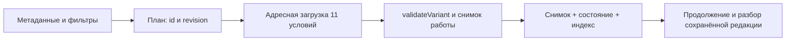

# Архитектура банка и вариантов

Срез: 14 октября 2026 года. Документ формируется вместе с матрицей командой `npx tsx scripts/report-oge-coverage.ts`. Описана существующая React/Vite-витрина и её локальное хранение; серверные API и база Next.js не заменяются.

## От индекса к полной редакции

Банк содержит 285 упражнений: 253 текущих ОГЭ, 2 прежние редакции ОГЭ и 30 ЕГЭ. `registry.ts` с полными объектами применяется в скриптах и предметных проверках. Пользовательские страницы читают `catalog.ts` / `exercise-index.json` с метаданными. Привязка id к порции генерируется в `exercise-loaders.ts`.

Полные условия разделены на **24 порции по не более чем 20 упражнений**. Это количество JSON-порций текущего набора, а не обещание постоянного числа файлов. `loadExercise(id)` обращается к нужной порции; `loadExercises(ids)` объединяет нужные порции и возвращает только запрошенные объекты. Внутри порции могут загрузиться соседние задания. Кэши Promise стабильны, одинаковые запросы объединяются. Отклонённый Promise также сохраняется до явного сброса кэша или полной перезагрузки: повторный React-render получает тот же thenable и сам не начинает новый сетевой запрос. Пользовательский повтор в ContentBoundary выполняет полную перезагрузку. Старые неиспользуемые файлы в каталоге shards не считаются доступными, если их нет в сгенерированном загрузчике.

Полнотекстовый `exercise-search.json` подключён к отложенному модулю страницы банка. Главная его не загружает; при открытии банка текущая версия читает весь поисковый индекс сразу, даже без запроса. Это отдельный компактный индекс текста, без ключей и разборов; условия остаются адресными. Отложенная загрузка самого индекса до поискового ввода пока не реализована.

`lesson-loaders.ts` отделён от статического полного registry; глава загружается по topicId. `lesson-search.json` содержит тексты параграфов с topicId, revision и sectionId, поэтому поиск может вести к якорю конкретного параграфа. Наличие поискового индекса не удостоверяет предметное качество совпадения.

На главной странице, обзоре ОГЭ и странице теории восстановление истории отдельных упражнений не обращается к полным условиям: App пропускает этот эффект для этих маршрутов. Обзор читает компактные записи работ и их метаданные. На страницах, где нужна проверка прежних ответов, `readAttemptsAddressed` загружает условия только для имеющихся id, а не весь банк. При восстановлении старого или повреждённого индекса может понадобиться отдельное чтение снимка.

## Генерация варианта

`generateVariantMetadata` выбирает по индексу 11 ссылок для № 2–12 и согласованные исходные тексты. Для полной работы добавляются изложение с аудио и сочинение к тому же тексту, что № 10–12. Метаданные содержат предварительный `generationEligible`; перед началом `sessionFromVariant` вызывает `validateVariant` на **полных выбранных условиях**. Только после этого создаётся и сохраняется работа. Проверка ключа, прав, редакционных стадий и финальной редакции в `eligible` остаётся обязательной.

Без дополнительных фильтров текущие пулы: **180** карточек для полного варианта и **225** для тестового из 253. № 2–3 имеют 10 согласованных общих текстов, № 10–12 — 23 для теста и 8 с сочинением; изложений с согласованным аудио — 5. Уровень, история и выбор только новых заданий уменьшают эти пулы. Новизна упражнений, письменных заданий, текстов и аудио учитывается раздельно; прежняя revision не подменяет выполнение текущей.

Существующие 5 полных вариантов сохраняют явные ссылки на редакции. Их загрузчик обращается только к условиям выбранного варианта. Генерация использует детерминированное перемешивание с seed. Для точного повторения требуются также specificationId, generationVersion, catalogVersion и ссылки id/revision. Seed без версии банка недостаточен.

Каталожный SHA-256: `62f7ca4ebfb03caca463c3ce35ba8711f234de644fc17d823939e3a16681ef90`. Сборщик хеширует файлы упражнений и `materials.json`. Хеш не охватывает уроки, игры и письменные разборы — у них собственные revision. Снимок сохраняет полные упражнения, выбранные задания письма, тексты и сведения об аудио, поэтому будущая редакция банка не меняет историческое условие. Ссылку на аудиофайл следует сохранять при публикациях: JSON-резервная копия не содержит сами звуковые байты.

## Локальная запись и восстановление

Основное асинхронное хранилище — IndexedDB `polina-oge-works-v2`, версия базы 1:

| Store | Содержимое | Обновление |
| --- | --- | --- |
| snapshots | Полный исходный снимок конкретной работы | Однократная запись по id |
| drafts | Ответы, выбранные темы, позиция, аудиосостояние, проверки и завершение | Транзакционная запись текущего состояния |
| index | Краткая запись, счётчики и ссылки на редакции | Для списка работ и фильтров истории |
| revisions | Предыдущие состояния контрольных точек | При завершении либо интервале не менее 60 секунд |

`saveSessionDurably` завершает транзакцию до объявления успешного сохранения. При запрете IndexedDB используется совместимый путь localStorage. Зеркало для старых вкладок сохраняется отдельно; отказ зеркала после успешной транзакции IDB не отменяет уже записанные ответы.

Совместимые ключи: `polina-oge-work-v1:<id>` для исходного снимка, `polina-oge-state-v2:<id>` для изменяемого состояния, `polina-oge-index-v2:<id>` для компактного списка. Первичная миграция копирует проверенную работу в IDB, **не удаляет и не переписывает автоматически прежнюю v1-запись**. Явное удаление пользователем удаляет эту работу и её состояния. При чтении выбирается свежая проверенная редакция; повреждённый дополнительный индекс восстанавливается из данных, а не изобретает ответы.

`SessionDraft` хранит отдельно текущий текст и последнюю успешно записанную основу. Отказ записи не повышает время последнего сохранения. Последующий ввод накапливается поверх черновика; повторная запись сравнивается с прежней успешной основой. `updatedAt` проверяется перед записью и внутри транзакции. Изменение в другой вкладке поступает через storage / BroadcastChannel; чистая вкладка обновляется, собственный несохранённый ввод получает конфликт. Интерфейс показывает обе редакции и допускает отдельную копию или резервный файл.

Список работ и обзор используют `listSessionSummariesDurably`: условия не перечитываются при обычной фильтрации и пагинации истории. Открытие конкретной работы обращается к её снимку. Полное чтение всей истории используется намеренно при экспорте всех работ, а не для рисования списка.

Для исторических полных работ validateVariant(variant, materials, {mode: "snapshot"}) проверяет структуру, формат, модели и связи общего текста/письма/аудио, не применяя современный publication guard к прежнему условию. parseSession использует именно этот режим. Например, реальный доаудитный №7-013 revision 1 с «гн…тся(8)т» сохраняется и переносится в собственном снимке; current eligible/publication по-прежнему отклоняет эту повреждённую редакцию. Историческое восстановление не исправляет условие задним числом и не означает нынешнего допуска ключа или материала.

## Резервная копия и код воспроизведения

Формат резервной копии: `polina-oge-backup`, version 1. Экспорт содержит полные снимки и состояния, письменные тексты и оценочные листы, а также описания воспроизведения. Импорт проверяет размер до 20 МБ, JSON, формат/версию, число работ 1–200 и каждый снимок через `parseSession`, включая редакции, формат и связи. Все записи проверяются до начала импорта. Для всей истории prepareBackupParts предварительно формирует независимые компактные UTF-8-файлы по 1–200 работ и не более 20 000 000 байт каждый; при 201 работе получаются части 200+1. Все части подготовлены до первого скачивания, список частей доступен в результатах. Один снимок не делится: он должен помещаться в 20 МБ и в 3 000 000 символов сериализованного JSON (String.length), как при восстановлении. Превышение/ошибка показывает понятный отказ, исходные данные остаются в браузере; все потребители download обрабатывают ошибку. При совпадении id создаётся отдельная копия; при отказе фактической записи интерфейс сообщает, сколько работ удалось сохранить.

Отдельное описание `polina-oge-generation`, version 1 включает seed, версии модели/генерации/каталога, тип и режим работы, id/revision условий, текстов и аудио, выбранные темы. Из результатов можно скачать код и загрузить его на странице генератора: создаётся отдельная попытка с очищенными ответами и теми же условиями. Сначала используется совпадающий сохранённый снимок, включая историческую редакцию; при его отсутствии адресно загружаются только ссылки текущего каталога и проверяется полный состав. Неизвестная прежняя редакция не заменяется новым заданием: нужен полный резервный файл со снимком. Максимум кода — 1 МБ; модель, редакции, уникальность ссылок, темы и связи текстов/аудио проверяются до сохранения. Код состава не является резервной копией звуковых файлов или полной работой ученика.

Завершённая работа показывает исходное сохранённое условие и общий текст, варианты ответа, введённый ответ, правильный результат и различия, выбранную формулировку письма и сохранённую рубрику. Печать относится к этой редакции. Самопроверка, реальный экспертный лист, недостаточный объём и пустой ответ имеют разные статусы; автоматическая тестовая часть не превращается в официальный итоговый балл.

## Учебные состояния и границы проверки

Игры сохраняют revision ситуации и её снимок при результате, незавершённое действие — отдельно. Первая самостоятельная попытка отделена от результата после подсказки и повторной проверки. Прежние записи без снимка не переоцениваются как текущие ситуации. Уроки сохраняют состояние учебного действия; достижение после раскрытия пояснения не считается новым независимым переносом.

Пользовательская граница ошибок `ContentBoundary` показывает повторную загрузку при отказе материалов. Сохранённые данные остаются в браузере; это не обещание восстановить текст, который ни разу не был записан. Кэши модулей/JSON не удаляют отклонённый Promise автоматически. React.use должен получить стабильный thenable и передать отказ границе ошибки; создание нового запроса при каждом render приводит к циклу загрузки вместо сообщения. Явный повтор полной перезагрузкой создаёт новый контекст загрузки; отдельные reset API используются только по явному действию, без автоматического retry.

`scripts/benchmark-bank.mjs` создаёт изолированные синтетические банки на 1000 и 5000 записей для браузерной проверки загрузки, поиска, фильтрации, пагинации, открытия, возврата, истории и формирования работы. Эти записи не публикуются и не увеличивают 253 реальных заданий. Результаты и условия запуска должны приводиться в отчёте сценариев; эта схема хранения сама по себе не доказывает время отклика.

Материалы происходят из 44 зарегистрированных файлов (9 DOCX, 35 PDF), 43 непустых. Разметка 64 поднавыков — editorial-draft по шаблонам, 253 текущих упражнений ожидают решения преподавателя. Архитектура сохраняет эти статусы и права; она не предоставляет разрешение на публикацию стороннего сборника.
